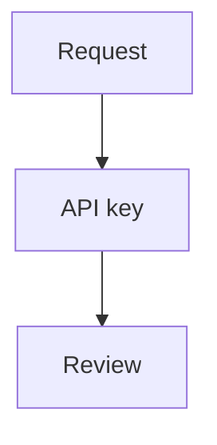

# Second Document

This is a second Markdown fixture for checking document selection in directory
preview mode.

## Checklist

- Switch between this document and `comprehensive.md`.
- Add a comment to confirm comments remain scoped to this document.
- Edit this line to confirm document-scoped hot reload works.

## Sample Code

```ts
const documentName = "second.md";
console.log(`Previewing ${documentName}`);
```

## Access Policy

Reviewers authenticate with workspace API keys.

API keys expire after 30 days and are rotated manually.

| Setting | Value |
| --- | --- |
| Authentication | API key |
| Lifetime | 30 days |

```ts
const authentication = "api-key";
const tokenLifetime = "30d";
```



## Review Notes

Review notes remain attached to their current document.

Legacy API keys may be reused across review sessions.

Resolved feedback remains available in the comment history.

Review decisions are saved with the document.
