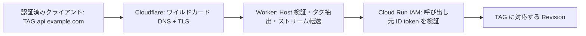

# Cloud Run Revision Tag proxy

`TAG.api.example.com` を Cloudflare Workers で Cloud Run のタグ付き URL に
転送します。初期設定後は Cloud Run にタグを追加するだけで利用できます。 Google
Cloud Load Balancer、Cloud Run Domain Mapping、Session Affinity は
使用しません。タグごとの DNS、Worker Route、対応表も不要です。

## アーキテクチャと既存環境



このリポジトリは Deno サーバーを `src/server/`、npm のブラウザクライアントを
`src/preview/` に配置しています。Terraform と既存の Cloudflare
設定はありません。 Worker は独立した npm パッケージ `workers/cloud_run_proxy/`
とし、既存の 依存関係・ロックファイルを変更しません。追加の開発依存は Wrangler
だけです。 テスト、lint、TypeScript 型チェックは既存と同じ Deno を使用します。

既存の `.github/workflows/cloud_run_preview.yml` は Workload Identity Federation
で Cloud Run に `pr-番号` タグを作成し、PR を閉じるとタグを削除します。
その処理と既存の IAM 設定は変更しません。例えば `pr-42` は
`pr-42.api.example.com` で利用できます。既存ワークフローの疎通確認は直接の Cloud
Run URL を使用するため、この Worker の IAM 保護とは独立しています。

責務は次のように分けます。

| 対象                                                         | 管理元                                    |
| ------------------------------------------------------------ | ----------------------------------------- |
| Worker コード、環境変数、単一ワイルドカード Route            | Wrangler による手動デプロイ               |
| ワイルドカード DNS、Proxy、Edge TLS 証明書、Route の競合確認 | 初期設定時に Cloudflare 管理画面で管理    |
| Cloud Run サービス、Revision Tag、IAM、ingress               | 既存の GCP 管理方法 / PR preview workflow |

Terraform は新規導入しません。将来導入する場合も同じ Route を Terraform と
Wrangler の両方から管理しないでください。Route を Terraform に移管する場合は
Wrangler の `routes` の責務を先に移管してから適用します。

## 認証方式と適用条件

現在の方式は **呼び出し元の Google ID token の転送** です。
`Authorization: Bearer GOOGLE_ID_TOKEN` を維持し、Cloud Run が署名、有効期限、
audience、Invoker 権限を検証します。Worker 自体は token を発行・保存せず、
Bearer の有無だけを確認します。Worker の通過は認証成功を意味しません。 token
が無い場合は Worker が 401、無効な token は Cloud Run の 401/403 に
なります。OAuth access token ではなく ID token が必要です。

サービスアカウントなどから取得する token の audience は、**タグ付き URL や
Cloudflare ドメインではなく、Cloud Run のサービス URL** にしてください。 既存の
custom audience を利用する場合はその設定に合わせてください。
[Google のサービス間認証仕様](https://docs.cloud.google.com/run/docs/authenticating/service-to-service)
では、タグへのリクエストでもサービスの audience を使用します。

既存の IAM を無効化したり、`allUsers` を追加したりしないでください。 Cloud Run
の Invoker IAM check が有効で、意図しない公開 IAM binding が無いことを
管理者が確認してください。IAM はサービス単位であり、タグの存在を隠す仕組みや
タグごとのアクセス権を提供するものではありません。

Cloudflare から `run.app` に到達できる既存の ingress と、既定 URL が有効である
ことが前提です。`internal` / `internal-and-cloud-load-balancing` の ingress や
無効化済み `run.app` URL には、この構成だけでは到達できません。アクセス制御を
自動的に緩める変更はしません。要件が合わない場合は運用管理者と別途設計が必要です。

ブラウザの通常の画面遷移、ネイティブ EventSource、ブラウザ WebSocket は任意の
Authorization ヘッダーを付けられません。現在は認証ヘッダーを送れる
API/非ブラウザ クライアントを対象とします。SSE は認証ヘッダー付き `fetch`
でも利用できます。 アプリの Authorization
を別に使用する用途やブラウザ向け代理認証には、Cloudflare Access
等によるユーザー認証と、GCP WIF / token broker の認証方式を先に設計する
必要があります。サービスアカウント鍵や固定の期限付き ID token を Worker に
埋め込まないでください。クエリに token を載せる回避策も使用しません。

## Cloud Run の実際の URL を確認する

[Cloud Run の公式 URL 仕様](https://docs.cloud.google.com/run/docs/triggering/https-request)
では `https://[TAG---]SERVICE_IDENTIFIER.run.app` および deterministic URL を
説明しています。サービス識別子の内部形式は固定されていません。 `status.url` は
deterministic URL を優先する場合もあるため、その文字列だけから タグ付き URL
を推測しません。

最初に既存のタグを 1 つ選び、実際の Cloud Run 出力を読み取ります。以下は読み取り
操作です。`PROJECT_ID`、`REGION`、`SERVICE`、`CLOUD_RUN_SAMPLE_TAG` は実環境の
値に置き換えてください。コマンドには `gcloud` と `jq` が必要です。

```sh
export CLOUD_RUN_SAMPLE_TAG=pr-42
gcloud run services describe "$SERVICE" \
  --project "$PROJECT_ID" --region "$REGION" --format=json \
  > /tmp/cloud-run-proxy-service.json

export CLOUD_RUN_SERVICE_URL="$(jq -er '.status.url' /tmp/cloud-run-proxy-service.json)"
export CLOUD_RUN_SAMPLE_TAG_URL="$(jq -er --arg tag "$CLOUD_RUN_SAMPLE_TAG" \
  '.status.traffic[] | select(.tag == $tag) | .url' /tmp/cloud-run-proxy-service.json)"
```

`configure` は実際のタグ付き URL が `SAMPLE_TAG---` で始まること、HTTPS、
`run.app`、DNS の長さと構文を検証し、プレフィックスを除いたホストを
`CLOUD_RUN_TAG_HOST` として生成します。両 URL に認証情報、パス、クエリを
含めることはできません。地域名、プロジェクト番号、ハッシュの解析は行いません。
サンプルタグは初期設定時の形式確認だけに使用し、実行時には参照しません。
サンプルタグの削除後も他のタグは利用できます。

## Cloudflare 初期設定、DNS と TLS

以下は **本番に適用する変更内容** です。この実装作業では実行していません。
管理者が対象 zone / account と既存リソースの競合を確認してから適用してください。

1. 対象ドメインを Cloudflare の有効な zone として登録します。
2. DNS に `*.api.example.com`（`example.com` zone なら名前 `*.api`）の **A
   レコード `192.0.2.1`、Proxied 有効、TTL Auto** を 1 つ作成します。
   これは文書用 IP のダミー origin です。Worker が実際の Cloud Run に fetch
   するため、DNS は Cloud Run を直接指す必要がありません。Worker が外れた場合も
   Cloud Run に直接迂回しません。実際の通信先 IP としては使いません。
3. `*.api.example.com` を SAN に含む Edge 証明書を準備し、Active を確認します。
4. TLS を確認後、Wrangler で `*.api.example.com/*` の Route と Worker
   を配置します。 これは HTTP と HTTPS の両方にマッチしますが Worker は HTTPS
   のみ受け付けます。
5. より具体的な DNS レコード、Worker Route、Worker 無しの例外 Route、別の Custom
   Domain が処理を上書きしていないことを確認します。Route の障害モードは fail
   closed とし、Worker の割当が外れていないことも確認してください。

[ワイルドカード DNS](https://developers.cloudflare.com/dns/manage-dns-records/reference/wildcard-dns-records/)
と
[Worker Route](https://developers.cloudflare.com/workers/configuration/routing/routes/)
は別の設定です。DNS のワイルドカードは多階層にマッチすることがありますが、
Worker は `TAG` の単一ラベルのみ受け付けます。

**通常の full setup の `example.com` zone の Universal SSL は
`*.api.example.com` をカバーしません。** `*.example.com` は `v1.api.example.com`
に対して無効です。
[Universal SSL の制約](https://developers.cloudflare.com/ssl/edge-certificates/universal-ssl/limitations/)
に従い、[Advanced Certificate Manager](https://developers.cloudflare.com/ssl/edge-certificates/advanced-certificate-manager/)
の追加契約で明示的なワイルドカード証明書を発行するか、利用プランが対応する
カスタム証明書をアップロードします。DNS DCV、CAA、証明書更新を確認します。 Total
TLS に個別タグの証明書作成を任せる方式は採用しません。partial / CNAME setup
でもワイルドカード証明書と DCV を別途確認してください。

証明書の SAN と実際の検証を確認します。例えば以下は読み取り検証です。

```sh
openssl s_client -connect v1.api.example.com:443 \
  -servername v1.api.example.com -verify_hostname v1.api.example.com \
  -verify_return_error </dev/null
curl --silent --show-error --output /dev/null --write-out '%{http_code}\n' \
  https://new-tls-check.api.example.com/
```

Worker 配置後、token 無しの後者は TLS が正常で Worker の 401 になることが期待値
です。証明書の確認では `curl -k` を使用しません。

## プランと必要最小限の権限

Worker 自体は Workers Free または Paid で利用できます。リクエスト量、CPU、
アップロード上限、同時接続、長時間 SSE / WebSocket は
[Workers の制限](https://developers.cloudflare.com/workers/platform/limits/) と
Cloud Run の request timeout に従います。本文をストリーミングしても
プラットフォームのアップロード制限は解除されません。本番の負荷に合わせて
プランを選び、深いサブドメイン用の ACM またはカスタム証明書を別途用意します。

手動デプロイ用 API Token は対象 account / zone
だけに限定し、次の権限を付与します。

- Account / Workers Scripts / Edit
- Zone / Workers Routes / Edit
- Zone / Zone / Read

この token に DNS Edit、SSL and Certificates Edit、GCP IAM の権限は不要です。
DNS / 証明書の初期設定は別の管理者権限で行います。GCP の呼び出し元は対象サービス
に必要な `roles/run.invoker` のみを持ち、Worker デプロイには GCP
権限を与えません。
[Wrangler の認証手順](https://developers.cloudflare.com/workers/wrangler/commands/#login)
を参照し、API Token をソースや設定ファイルに保存しないでください。

## Wrangler とローカル開発

Node.js 24、npm、Deno 2.8.0 を使用します。ルートの npm install
とは独立しています。

```sh
cd workers/cloud_run_proxy
npm install
npm run lint
npm run typecheck
npm run typecheck:workers
npm test
npm run build
npm run test:runtime
```

`typecheck` は Deno の TypeScript コンパイラ、`typecheck:workers` は Wrangler が
生成する実行環境の型に対するチェック、`build` は Wrangler の dry-run です。本番
Worker に Node 互換 API は不要です。互換性日付は設定生成とローカル設定で
同じ値を使用しています。開発依存を取得できない環境でも lint、typecheck、test は
実行できます。Workers 固有の 101 / WebSocket は `test:runtime` で確認します。

`wrangler.jsonc` の値は例示用です。実環境のドメインと、確認済みホストを Git
除外済みの `.dev.vars` に設定して上書きします。

```dotenv
BASE_DOMAIN=api.example.com
CLOUD_RUN_TAG_HOST=replace-with-observed-service-host.run.app
```

```sh
npm run dev
```

ローカル HTTPS 開発サーバーに公開 Host を保って接続するには、例えば以下を使用
します。`GOOGLE_ID_TOKEN` は別途安全に取得し、保存・ログ出力しないでください。
`--noproxy` は手元の開発環境でループバックに直接接続するための指定です。

```sh
curl --insecure --noproxy '*' \
  --connect-to v1.api.example.com:443:127.0.0.1:8787 \
  -H "Authorization: Bearer $GOOGLE_ID_TOKEN" \
  'https://v1.api.example.com/path?q=value'
```

`--insecure` は Wrangler の自己署名ローカル証明書に限ります。本番接続では
使用しません。ポート付き Host や `localhost` は検証で拒否されるため、
`--connect-to` で公開ホストのままローカル接続します。ローカル Worker の fetch
先は実際の Cloud Run なので、書き込み操作は開発用サービスで行ってください。

## 環境設定とデプロイ

初回と Worker のコード・環境設定変更時に、CI が通った main のコミットを
チェックアウトして、Wrangler で手動デプロイします。Revision Tag
の追加・削除時には Worker の再デプロイは不要です。

必要なツールをインストールして検証した後、次を環境変数に設定し、前述の実際の
Cloud Run URL も渡します。

```sh
export BASE_DOMAIN=api.example.com
export WORKER_NAME=sadoku-cloud-run-proxy
export CLOUDFLARE_ACCOUNT_ID=REPLACE_WITH_32_HEX_ACCOUNT_ID
export CLOUDFLARE_ZONE_ID=REPLACE_WITH_32_HEX_ZONE_ID
npm run configure
```

生成した `wrangler.deploy.json` をローカルでレビューしてください。このファイルは
Git 除外済み、ファイル権限 0600 で、API Token を含みません。レビュー対象は
Worker 名、account / zone、ドメイン、確認済み転送先、単一のワイルドカード Route
です。認証済みの Wrangler または環境変数 `CLOUDFLARE_API_TOKEN` を使用します。

```sh
# DNS/TLS と変更内容を確認し、適用の承認後にだけ実行する
npm run deploy
```

`workers.dev` と preview URL は無効です。別環境には別の domain / Worker 名を
指定し、configure から同じ手順で配置してください。

## CI と手動デプロイの設定

`.github/workflows/cloudflare_worker.yml` は PR と main で lint、型チェック、
自動テスト、Wrangler dry-run、Workers runtime テストを行います。
`workflow_dispatch` でも検証だけを実行します。既存の
`.github/workflows/test.yml` と Cloud Run preview は独立して継続します。Actions
の参照は既存と同じ commit SHA に固定し、GitHub 権限は contents:read だけです。

Worker の自動デプロイは行いません。このワークフロー用の GitHub Secrets /
Variables や GitHub Environment の登録は不要です。Cloudflare の認証情報も CI
に渡しません。 手動デプロイ時には、次をローカルの環境変数で渡します。

| 環境変数                   | 内容                                                  |
| -------------------------- | ----------------------------------------------------- |
| `BASE_DOMAIN`              | `api.example.com` に相当する許可ドメイン              |
| `WORKER_NAME`              | 対象の Worker 名                                      |
| `CLOUDFLARE_ACCOUNT_ID`    | 対象 account ID                                       |
| `CLOUDFLARE_ZONE_ID`       | 対象 zone ID                                          |
| `CLOUD_RUN_SERVICE_URL`    | 実際のサービス URL、IAM audience の確認用             |
| `CLOUD_RUN_SAMPLE_TAG`     | 初期確認に使用したタグ                                |
| `CLOUD_RUN_SAMPLE_TAG_URL` | Cloud Run が返したそのタグの URL                      |
| `CLOUDFLARE_API_TOKEN`     | 限定権限を持つ API Token（Wrangler 認証済みなら不要） |

API Token
はデプロイする端末の安全な認証管理から取得し、必要な実行時だけ渡します。
生成設定や Wrangler のログを公開 artifact にアップロードしません。Worker 本体は
リクエストの URL、ヘッダー、本文をログ出力しません。

## Revision Tag の追加と受け入れ確認

既存 preview workflow はそのまま利用できます。手動で既存 revision にタグを
付ける場合の例は次のとおりです。これは GCP の変更操作なので、運用で確認して
実行してください。既存の他のタグを残す `--update-tags` を使用しています。

```sh
gcloud run services update-traffic "$SERVICE" \
  --project "$PROJECT_ID" --region "$REGION" \
  --update-tags "v1=$REVISION_V1,staging=$REVISION_STAGING"
```

`v1.api.example.com` と `staging.api.example.com`
へ認証済みリクエストを送ります。 次に新しいタグ `v2` を付け、DNS / Worker /
Route / Domain Mapping を変更せずに `v2.api.example.com` から **実際の revision
識別情報** が返ることを確認します。 使用するアプリのヘルスエンドポイントや
revision 応答ヘッダーで区別してください。 Cloud Run の Session Affinity
は無効のままで、必要な共有状態はアプリで扱います。

タグは小文字英字で始まり、英数字とハイフンのみ、末尾は英数字です。
単一ラベル、最大 63 文字、`---` は禁止です。さらに `TAG---` と origin の
先頭ラベルを合わせた DNS ラベルが 63 文字以内である必要があります。
長いサービス名の deterministic URL でタグの長さが足りない場合は、Cloud Run が
実際に返す短い hash-based タグ URL を初期設定時に選んでください。

存在しないタグは Cloud Run の 404 などをそのまま返します。DNS / ネットワーク
障害なら 502 です。既定 revision への fallback はしません。サービスを削除して
再作成した場合やドメインを変更する場合は初期設定をやり直してください。

## セキュリティと互換性

- Host と URL の authority が一致し、許可ドメイン直下の正しいタグである場合
  だけ転送します。パスの
  `//`、クエリ、偽装ヘッダーで転送ホストを変更できません。 転送先は HTTPS
  の設定済み `run.app` だけです。
- `Host` はタグ付きホストに設定し、`X-Forwarded-Host/Proto/Port` は Worker が
  上書きします。クライアントの `Forwarded`、`X-Forwarded-*`、`CF-*`、
  `X-Real-IP`、`X-Serverless-Authorization` などは除去します。 クライアント IP
  をアプリの認可判断に使わないでください。GCP が付ける転送
  ヘッダーの扱いもアプリで確認します。
- メソッド、パス、クエリ、本文を保持します。ホップ単位のヘッダーは除去し、
  Chunked のフレーミングは各 HTTP 接続に任せます。SSE と大きな本文は読み込み
  完了を待たずストリームを返し、WebSocket 101 は socket を保持して返します。
- リダイレクトは自動追跡しません。同じサービスの内部 Location は対応する
  公開ホストに書き換え、別 Cloud Run サービスには 502 を返します。相対 Location
  や外部 OAuth サイトへの Location は維持します。外部リダイレクトの許可方針は
  アプリで管理し、API の token 付き呼び出しで無条件の `curl -L` は避けます。
- Cookie の Domain 属性はすべて削除して host-only にします。複数 Set-Cookie、
  Expires、Path、Secure、HttpOnly、SameSite は維持します。タグ間の Cookie 共有を
  前提にしないでください。Cookie 認証で Cloud Run IAM の代わりにはできません。
- HTML / JSON 本文や Link ヘッダーの絶対 URL は書き換えません。アプリは外部 URL
  設定か、信頼するプロキシの `X-Forwarded-Host` / `Proto` から公開 URL を生成
  してください。本文内の `run.app` URL、OAuth callback、CORS、CSP はアプリ側の
  設定対象です。Refresh / Content-Location は内部 URL
  の露出防止のため除去します。
- Workers 自体のキャッシュを無効にし、origin fetch は `cache: no-store`、応答も
  `Cache-Control` / CDN ヘッダーを `no-store` にします。Cache API
  は使用しません。 詳細は
  [Workers caching の設定](https://developers.cloudflare.com/workers/cache/configuration/)
  と
  [fetch の仕様](https://developers.cloudflare.com/workers/runtime-apis/fetch/)
  を参照してください。

## トラブルシューティングと検証範囲

| 症状                             | 確認事項                                                                    |
| -------------------------------- | --------------------------------------------------------------------------- |
| TLS エラー                       | `*.api.example.com` の SAN、証明書の Active、DCV / CAA、DNS Proxy           |
| DNS エラー / 522                 | wildcard DNS、Proxy、Worker Route の割当と競合                              |
| Worker 400 / 421                 | Host / ポート / 階層 / タグ構文 / origin ラベル長 / HTTPS                   |
| Worker 401                       | Authorization に Google ID token を付けたか                                 |
| Cloud Run 401 / 403              | token の audience、期限、署名、Invoker IAM、ingress                         |
| 404                              | `status.traffic` のタグと URL、削除済みタグ、アプリ自身の 404               |
| 502                              | origin DNS / 接続、誤った host、別サービスへの内部リダイレクト              |
| SSE の遅延・切断                 | アプリの flush、Cloud Run timeout、クライアント側バッファ、両サービスの制限 |
| WebSocket が開けない             | 認証ヘッダーを付けられるクライアントか、GET Upgrade、アプリの対応と timeout |
| タグ間で URL / Cookie が合わない | アプリの公開 URL、Domain 共有依存、CORS / OAuth の設定                      |
| 手動デプロイに失敗する           | Wrangler 認証、API Token の権限、生成設定の account / zone / Route          |

単体テストはタグ抽出、拒否、GET/POST/PUT/DELETE 等、バイナリ本文、クエリ、
ストリームの逐次配送とキャンセル、SSE、リダイレクト、Cookie、欠損タグを含む
4xx/5xx、SSRF 防止を検証します。Workers runtime テストは Wrangler の
`createTestHarness` とモック origin で、アップロード、SSE、複数 Cookie、
WebSocket の 101 とフレームを検証します。これらは実際の GCP IAM / DNS / TLS や
Cloud Run への到達性を証明するものではありません。

本番接続情報がない環境では、実際のサービス URL、IAM、ingress、Session Affinity、
証明書 SAN、タグ追加後の疎通は未検証です。上記の初期設定・受け入れ確認を
実環境で完了してから手動デプロイしてください。
